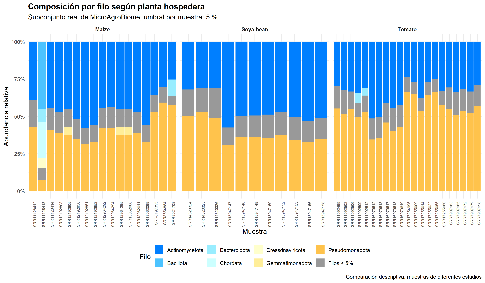

# Construcción y exploración visual de datos bioinformáticos con ggplot2

En la sesión anterior importamos, limpiamos e integramos un **subconjunto de datos reales del proyecto [MicroAgroBiome](https://agrobiom.matmor.unam.mx/)**, y construimos tablas de abundancias relativas por género y filo. Ahora aprenderemos a **comunicar lo que contienen esas tablas** mediante gráficos reproducibles. No utilizaremos `phyloseq`: trabajaremos con `dplyr`, `tidyr` y `ggplot2`.

**Objetivos.** Reconocer las capas de `ggplot2`; distinguir datos, estéticas y geometrías; elegir gráficos según la pregunta; comparar muestras y hospederos con facetas; ordenar categorías mediante factores; ajustar colores y etiquetas; y exportar figuras. Las comparaciones serán **descriptivas**: las muestras proceden de diferentes estudios y pueden diferir en metodología y profundidad de secuenciación.

## La gramática de gráficos: construir una figura por capas

Un gráfico no es una instrucción única: se construye sumando **capas** con `+`. Los componentes esenciales son:

| Componente | Pregunta que responde | Ejemplo |
|---|---|---|
| Datos | ¿Qué tabla contiene las observaciones? | `ggplot(profundidad)` |
| Estéticas (`aes()`) | ¿Qué variables representan los ejes y los colores? | `aes(x = sample_id, y = total_lecturas)` |
| Geometría (`geom_*()`) | ¿Cómo se dibujan los datos? | `geom_col()` |
| Facetas (`facet_*()`) | ¿Separamos los datos en paneles? | `facet_wrap(~ host_name)` |
| Escalas (`scale_*()`) | ¿Cómo se representan valores, colores y etiquetas? | `scale_y_continuous()` |
| Etiquetas y tema | ¿Cómo facilitamos la lectura? | `labs()`, `theme_minimal()` |

La estructura general es:

```{r}
#| eval: false
ggplot(tabla, aes(x = variable_x, y = variable_y)) +
  geom_col() +
  labs(title = "Título informativo", x = "Eje X", y = "Eje Y") +
  theme_minimal()
```

La estética `aes(fill = host_name)` **asocia una variable con colores**; en cambio, `geom_col(fill = "#367A90")` asigna un **color fijo**. Un mismo gráfico puede tener mapeos globales en `ggplot()` y mapeos locales dentro de una geometría.

## Antes de comenzar: datos y paquetes

Utilizaremos la misma carpeta `data_raw/datos_rizosfera/` de la sesión anterior. Los archivos `conteos_taxonomia_rizosfera.tsv` y `metadata_rizosfera.csv` son los mismos: **no hay que descargar otra base**. 

```{r}
library(readr)
library(dplyr)
library(ggplot2)

# Resultados procesados en la sesión anterior
generos_5 <- read_tsv("results/generos_5.tsv")
filos_5 <- read_tsv("results/filos_5.tsv")
totales_muestra <- read_tsv("results/totales_muestra.tsv")

# Metadatos originales
metadata_riz <- read_csv(
  "data_raw/datos_rizosfera/metadata_rizosfera.csv"
)
```


### Preparar la información para las gráficas

En la sesión anterior calculamos el total de lecturas contabilizadas por muestra y lo guardamos en `totales_muestra`.

Esta tabla contiene dos columnas:

- `sample_id`: identificador de la muestra.
- `total_lecturas`: suma de los conteos taxonómicos de esa muestra.

Para representar los resultados según la planta hospedera o el país, necesitamos incorporar esas variables desde la tabla original de metadatos.

```{r}
profundidad <- totales_muestra %>%
  left_join(
    metadata_riz %>%
      select(sample_id, host_name, country, crop_system),
    by = "sample_id",
    relationship = "one-to-one"
  )

stopifnot(!anyNA(profundidad$host_name))

glimpse(profundidad)
```

**Observa que no estamos recalculando la profundidad.** Simplemente agregamos información descriptiva a los totales que ya habíamos obtenido.

La tabla `profundidad` será nuestro punto de partida para construir los primeros gráficos con `ggplot2`.

## Primer gráfico: profundidad de lecturas por muestra

La primera pregunta es: **¿cuántas lecturas contabilizadas tiene cada muestra?** Ya calculamos `total_lecturas`, de modo que `geom_col()` representa directamente esa variable en el eje vertical.

```{r}
p_profundidad <- ggplot(profundidad, aes(x = sample_id, y = total_lecturas)) +
  geom_col(fill = "#367A90") +
  labs(title = "Conteos totales por muestra", x = "Muestra",
       y = "Lecturas contabilizadas") +
  theme_minimal(base_size = 12) +
  theme(axis.text.x = element_text(angle = 90, hjust = 1, size = 6))
p_profundidad
```

**¿Por qué `geom_col()` y no `geom_bar()`?** `geom_bar()` cuenta filas automáticamente; `geom_col()` utiliza los valores numéricos de `y` que ya calculamos. Si aplicáramos `geom_bar()` a `profundidad`, contaríamos una fila por muestra, no las lecturas.

### Agregar información mediante colores

```{r}
p_profundidad_color <- ggplot(profundidad,
                             aes(x = sample_id, y = total_lecturas, fill = host_name)) +
  geom_col() +
  scale_fill_viridis_d(option = "viridis") +
  labs(title = "Conteos totales por muestra y planta hospedera",
       x = "Muestra", y = "Lecturas contabilizadas", fill = "Planta hospedera") +
  theme_minimal(base_size = 12) +
  theme(axis.text.x = element_text(angle = 90, hjust = 1, size = 6),
        legend.position = "bottom")
p_profundidad_color
```

Los colores indican a qué planta corresponde cada muestra, **no** la magnitud del conteo. Como hay muchas muestras y hospederos, la figura es difícil de leer: no todos los datos deben mostrarse simultáneamente en una sola gráfica. Más adelante mejoraremos su organización.

:::: {.callout-warning icon="false"}
## 🧠 Pregunta

Si cambiamos `aes(fill = host_name)` por `geom_col(fill = "steelblue")`, ¿qué información deja de representar el color?

::: {.callout-tip collapse="true" icon="false"}
## Solución

Deja de distinguir la planta hospedera. Todos los rectángulos tienen el mismo color fijo, aunque sus alturas sigan mostrando los conteos.
:::
::::


## Distribuciones: histograma y diagrama de caja

La profundidad también puede estudiarse **como distribución**, sin dibujar 75 etiquetas de muestras. Un histograma agrupa valores numéricos en intervalos; un diagrama de caja resume mediana, cuartiles y posibles valores extremos.

```{r}
p_hist <- ggplot(profundidad, aes(x = total_lecturas)) +
  geom_histogram(bins = 12, fill = "#367A90", color = "white") +
  labs(title = "Distribución de los conteos totales",
       x = "Lecturas contabilizadas por muestra", y = "Número de muestras") +
  theme_minimal(base_size = 12)
p_hist
```

`bins` controla el número aproximado de intervalos; `binwidth` permite fijar su anchura. El aspecto cambia al modificar estos parámetros, pero los datos originales no cambian.

```{r}
ggplot(
  profundidad,
  aes(
    x = reorder(host_name, total_lecturas, FUN = median),
    y = total_lecturas
  )
) +
  geom_boxplot(fill = "#83B7C9") +
  scale_y_log10(labels = scales::label_comma()) +
  coord_flip() +
  labs(
    title = "Profundidad de lectura según la planta hospedera",
    x = "Planta hospedera",
    y = "Lecturas contabilizadas (escala logarítmica)"
  ) +
  theme_minimal(base_size = 12)
```

:::: {.callout-warning icon="false"}
## 🧠 Pregunta

¿El histograma y el diagrama de caja muestran el número de lecturas de **cada muestra identificada**?

::: {.callout-tip collapse="true" icon="false"}
## Solución

No. Ambos resumen la **distribución entre muestras**; para identificar una muestra concreta necesitamos una tabla o una gráfica con identificadores.
:::
::::

:::: {.callout-warning icon="false"}
## 🧠 Pregunta

¿Por qué resulta útil utilizar una escala logarítmica en esta figura?
¿Podemos concluir que las plantas con mayor profundidad de lectura
tienen una mayor abundancia de microorganismos?

::: {.callout-tip collapse="true" icon="false"}
## Solución

La escala logarítmica permite visualizar muestras cuyas profundidades
difieren considerablemente, evitando que los valores más altos
compriman visualmente al resto.

No podemos concluir que una mayor profundidad implique una mayor
abundancia de microorganismos. La profundidad de lectura también
depende de las condiciones de secuenciación, el procesamiento
de las muestras y los estudios de procedencia.
:::
::::

## Composición taxonómica: barras apiladas

La pregunta ahora es diferente: **¿qué proporción de los conteos de una muestra corresponde a cada filo?** Utilizaremos `filos_5`, que ya contiene abundancias relativas. Con `fill = taxon_final`, cada segmento representa un filo o la categoría «Otros».

Vamos también a darles un orden a los Filos y géneros para efectos de los plots.

```{r}
orden_filos <- c(
  sort(setdiff(unique(filos_5$taxon_final), "Filos < 5%")),
  "Filos < 5%"
)

orden_generos <- c(
  sort(setdiff(unique(generos_5$taxon_final), "Géneros < 5%")),
  "Géneros < 5%"
)
```

```{r}
#install.packages("paletteer")
library(paletteer)

colores <- as.character(
  paletteer::paletteer_d("colorBlindness::Blue2Orange8Steps")
)

colores <- c(colores[1:7], "#999999")


p_filos <- ggplot(filos_5,
                  aes(x = sample_id, y = abundancia_relativa, fill = taxon_final)) +
  geom_col(width = 0.9) +
  scale_fill_manual(values = colores,
                    breaks = orden_filos) +
  scale_y_continuous(labels = function(x) paste0(round(100 * x), "%")) +
  labs(title = "Composición taxonómica por filo",
       x = "Muestra", y = "Abundancia relativa", fill = "Filo") +
  theme_minimal(base_size = 12) +
  theme(axis.text.x = element_text(angle = 90, hjust = 1, size = 6))
p_filos
```

Aquí cada barra suma 100 %. **No utilizamos `position = "fill"`** porque los datos ya son proporciones y su suma por muestra ya es 1. El gráfico muestra composición relativa, no el número absoluto de lecturas ni diferencias estadísticamente significativas.

### Mostrar un subconjunto para mejorar la legibilidad

Para explicar las facetas y los colores, seleccionaremos algunos hospederos **sin alterar sus abundancias**. El criterio es elegir los tres hospederos con mayor número de muestras en el subconjunto; en caso de empate, el orden alfabético decide.

```{r}
hospederos_elegidos <- profundidad %>%
  count(host_name, name = "n_muestras", sort = TRUE) %>%
  arrange(desc(n_muestras), host_name) %>%
  slice_head(n = 3) %>%
  pull(host_name)

filos_seleccionados <- filos_5 %>%
  filter(host_name %in% hospederos_elegidos)

profundidad_seleccionada <- profundidad %>%
  filter(host_name %in% hospederos_elegidos)

hospederos_elegidos
```

```{r}
p_filos_seleccionados <- ggplot(
  filos_seleccionados,
  aes(x = sample_id, y = abundancia_relativa, fill = taxon_final)
) +
  geom_col() +
  scale_fill_manual(values = colores,
                    breaks = orden_filos) +
  scale_y_continuous(labels = function(x) paste0(round(100 * x), "%")) +
  labs(title = "Composición por filo: hospederos seleccionados",
       x = "Muestra", y = "Abundancia relativa", fill = "Filo") +
  theme_minimal(base_size = 12) +
  theme(axis.text.x = element_text(angle = 90, hjust = 1, size = 7))
p_filos_seleccionados
```

## Facetas: comparar grupos sin mezclar sus muestras

`facet_wrap()` crea **un panel por categoría**; `facet_grid()` organiza paneles por **dos variables**. Los paneles mantienen una escala común por defecto, lo que facilita la comparación de proporciones.

```{r}
p_facet_wrap <- ggplot(filos_seleccionados,
                       aes(x = sample_id, y = abundancia_relativa, fill = taxon_final)) +
  geom_col() +
  scale_fill_manual(values = colores,
                    breaks = orden_filos) +
  facet_wrap(~ host_name, scales = "free_x") +
  scale_y_continuous(labels = function(x) paste0(round(100 * x), "%")) +
  labs(title = "Composición por filo según planta hospedera",
       x = "Muestra", y = "Abundancia relativa", fill = "Filo") +
  theme_minimal(base_size = 12) +
  theme(axis.text.x = element_text(angle = 90, hjust = 1, size = 7))
p_facet_wrap
```

`scales = "free_x"` permite que cada panel muestre solo sus identificadores de muestra; **la escala vertical sigue siendo común**. Esto es especialmente útil porque las muestras tienen nombres largos.

## `facet_grid()`: dos variables de metadatos

Usaremos `host_name` y `country`, pero **no todas las combinaciones están necesariamente representadas**. Una celda vacía significa que no hay observaciones para esa combinación en el subconjunto, no que se haya demostrado ausencia biológica.

```{r}
filos_pais <- filos_seleccionados %>%
  left_join(metadata_riz %>% select(sample_id, country),
            by = "sample_id", relationship = "many-to-one")

p_facet_grid <- ggplot(filos_pais,
                      aes(x = sample_id, y = abundancia_relativa, fill = taxon_final)) +
  geom_col() +
  scale_fill_manual(values = colores,
                    breaks = orden_filos) +
  facet_grid(host_name ~ country, scales = "free_x", space = "free_x") +
  scale_y_continuous(labels = function(x) paste0(round(100 * x), "%")) +
  labs(title = "Composición por hospedero y país",
       x = "Muestra", y = "Abundancia relativa", fill = "Filo") +
  theme_minimal(base_size = 10) +
  theme(axis.text.x = element_text(angle = 90, hjust = 1, size = 6))
p_facet_grid
```

::: {.callout-note}
## ¿Qué comparación es válida?

Los metadatos ayudan a **describir y organizar** las muestras. Como los hospederos, países y estudios pueden estar relacionados entre sí, estas figuras no permiten atribuir causalmente las diferencias de composición a una sola variable.
:::

## Accesibilidad y elección de colores

Al construir figuras científicas, es importante elegir paletas que permitan distinguir las categorías con claridad y que sean accesibles para personas con diferentes tipos de visión cromática. Conviene evitar combinaciones difíciles de distinguir, mantener un buen contraste con el fondo y no depender exclusivamente del color para comunicar información. Algunas alternativas conocidas son las paletas **viridis** y **ColorBrewer**, aunque su elección también depende del número de categorías y del tipo de variable que representamos.

Para explorar y seleccionar paletas de colores en R, podemos consultar:

- [R Charts: Color palettes](https://r-charts.com/color-palettes/#discrete)
- [ColorBrewer 2.0](https://colorbrewer2.org/)
- [Viridis: documentación del paquete](https://sjmgarnier.github.io/viridis/)

## Ajustes de presentación y exportación

Las etiquetas, tamaños de texto y dimensiones de la figura forman parte de una comunicación científica clara. Para una figura con muchas muestras, suele ser más eficaz **aumentar su anchura o reducir el número de muestras mostradas** que hacer ilegibles las etiquetas.

```{r}
p_publicacion <- p_facet_wrap +
  labs(subtitle = "Subconjunto real de MicroAgroBiome; umbral por muestra: 5 %",
       caption = "Comparación descriptiva; muestras de diferentes estudios") +
  theme(
    plot.title = element_text(face = "bold"),
    strip.text = element_text(face = "bold"),
    legend.position = "bottom"
  )
p_publicacion
```

## Guardar figuras con `ggsave()`

Trabajaremos con rutas **relativas al proyecto**, no con rutas personales como `D:/Users/...`. `ggsave()` permite exportar el objeto gráfico con dimensiones explícitas.

```{r}
dir.create("figures", showWarnings = FALSE)

ggsave("figures/composicion_filos_hospederos.png",
       plot = p_publicacion, width = 12, height = 7,
       units = "in", dpi = 300)

ggsave("figures/composicion_filos_hospederos.pdf",
       plot = p_publicacion, width = 12, height = 7,
       units = "in")
```

Para **SVG**, también podemos guardar una versión vectorial si nuestro entorno tiene un dispositivo SVG disponible:

```{r}
#| eval: false
ggsave("figures/composicion_filos_hospederos.svg",
       plot = p_publicacion, width = 12, height = 7, units = "in")
```

PNG es un formato de píxeles y `dpi = 300` controla la resolución de exportación. PDF y SVG son formatos vectoriales: sus líneas y textos pueden escalarse sin perder nitidez. El tamaño final y la legibilidad siguen siendo importantes en todos los formatos.


::: {.callout-note icon="false"}
## 🎨 Personalización adicional de gráficas con `theme()`

La función `theme()` de `ggplot2` permite modificar la apariencia de una gráfica: tamaños de letra, orientación de etiquetas, posición de la leyenda, títulos, fondos y líneas de referencia, entre otros elementos.

Por ejemplo, podemos agregar las siguientes opciones a cualquiera de nuestras gráficas:

```{r}
#| eval: false

theme(
  # Leyenda
  legend.text = element_text(size = 12, face = "italic"),
  legend.title = element_text(size = 13, face = "bold"),
  legend.key.size = grid::unit(0.5, "cm"),
  legend.position = "bottom",

  # Títulos de los ejes
  axis.title = element_text(size = 13),
  axis.title.x = element_text(face = "bold"),
  axis.title.y = element_text(face = "bold"),

  # Etiquetas de los ejes
  axis.text.x = element_text(size = 10, angle = 90, hjust = 1),
  axis.text.y = element_text(size = 11),

  # Título de la gráfica
  plot.title = element_text(size = 16, face = "bold", hjust = 0.5),
  plot.subtitle = element_text(size = 11),

  # Títulos de las facetas
  strip.text = element_text(size = 12, face = "bold"),

  # Fondo y cuadrícula
  panel.grid.major.x = element_blank(),
  panel.grid.minor = element_blank(),
  panel.background = element_rect(fill = "white", color = NA),

  # Márgenes
  plot.margin = margin(10, 10, 10, 10)
)
```

**Algunas consideraciones:**

- `element_text()` modifica textos; `element_blank()` elimina elementos visuales y `element_rect()` personaliza fondos y recuadros.
- `face = "italic"` aplica cursivas y `face = "bold"` aplica negritas.
- `hjust` controla la alineación horizontal del texto.
- `legend.position` puede tomar valores como `"top"`, `"bottom"`, `"left"`, `"right"` o `"none"`.

**Nota taxonómica:** los nombres científicos de los géneros (*Bacillus*, *Pseudomonas*, etc.) se escriben en cursivas, mientras que los nombres de filos y familias no. Si la leyenda contiene categorías como `"Géneros < 5%"`, aplicar `face = "italic"` a toda la leyenda también pondrá esa categoría en cursivas; en ese caso, es preferible dar formato únicamente a los nombres científicos.

Puedes consultar otras opciones en la [documentación oficial de `theme()` de ggplot2](https://ggplot2.tidyverse.org/reference/theme.html).
:::


## Extra: accesibilidad y comunicación responsable

La accesibilidad también es parte de una buena figura científica:

- **No depender únicamente del color.** Agregar títulos, ejes, etiquetas, paneles o una leyenda clara.
- **Evitar paletas difíciles de distinguir.** Verificar contraste y legibilidad para personas con alteraciones en la percepción del color.
- **No saturar la figura.** Si hay demasiadas categorías, seleccionar una pregunta más específica o dividir la visualización en paneles.
- **Usar tamaños legibles.** Revisar el resultado al tamaño al que se leerá, no solamente en el visor de RStudio.
- **Incluir texto alternativo** al publicar figuras en HTML o presentaciones: describir la pregunta, las variables y el patrón principal sin inferir causas.
- **Explicar las transformaciones.** Indicar si son conteos absolutos o abundancias relativas, el umbral de «Otros» y las limitaciones del conjunto.

Podemos agregar un texto alternativo a una imagen insertada en Quarto mediante Markdown:

```markdown

```

Colorear individualmente las etiquetas del eje según metadatos requiere técnicas adicionales (por ejemplo, `ggtext`); **no es necesario introducir otro paquete** en este curso. El color de las barras y las facetas ya permiten comunicar el hospedero.


## Ejercicios

### Ejercicio 1: 

Utilizando `generos_5` y `metadata_riz`:

1. Identifica las plantas hospederas que tienen **al menos 5 muestras**.
2. Conserva únicamente las muestras correspondientes a esas plantas.
3. Construye una gráfica de barras apiladas de abundancia relativa por género con `ggplot2`, utilizando `facet_wrap()` para comparar las plantas hospederas.

Personaliza la figura con una paleta de colores adecuada, etiquetas legibles y la categoría `"Géneros < 5%"` al final de la leyenda.

**Para discutir:** ¿Qué diferencias observas en la composición taxonómica entre las plantas? ¿Todas las muestras de una misma planta presentan composiciones similares?

### Ejercicio 2:

Utilizando `filos_5` y `metadata_riz`:

1. Identifica los países que tienen **al menos 5 muestras**.
2. Conserva únicamente las muestras correspondientes a esos países.
3. Construye una gráfica de barras apiladas de abundancia relativa por filo con `ggplot2`, utilizando `facet_wrap()` para comparar los países.

**Para discutir:** ¿Qué diferencias observas en la composición taxonómica entre los países? ¿Las muestras de un mismo país presentan composiciones similares?


## Créditos y lecturas complementarias

Este material fue modificado del material impartido en el curso intersemestral *Code & Data Bootcamp: Git, Bash y R*, secciones de visualización con `ggplot2`:

- [¿Por qué visualizar datos?](https://eveliacoss.github.io/Codedata_Bootcamp_Git_Bash_R2026_ENESJ/Parte30.html)
- [La gramática de los gráficos](https://eveliacoss.github.io/Codedata_Bootcamp_Git_Bash_R2026_ENESJ/Parte31.html)
- [Construyendo gráficas capa por capa](https://eveliacoss.github.io/Codedata_Bootcamp_Git_Bash_R2026_ENESJ/Parte33.html)
- [Estéticas globales y locales](https://eveliacoss.github.io/Codedata_Bootcamp_Git_Bash_R2026_ENESJ/Parte35.html)


