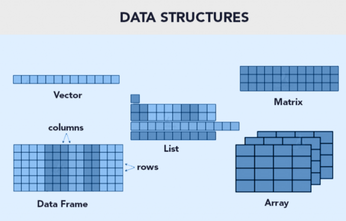

# Objetos y estructuras de datos en R

## Asignación, nombres y tipos básicos

Un **objeto** almacena un valor o una estructura que podremos reutilizar. Usaremos `<-` para asignar valores. Los nombres distinguen mayúsculas de minúsculas: `gen` y `Gen` son objetos distintos.


| Clases | Declaración de la variable | Conversión de formato | 
|-----------------|-----------------|-----------------|
| `numeric` | `numeric()` | `as.numeric()` | 
| `integer` | `integer()` | `as.integer()` | 
| `double` | `double()` | `as.double()` |  |
| `character` | `character()` | `as.character()` | 
| `logical` | `logical()` | `as.logical()` | 
| `factor` | `factor()` | `as.factor()` |  |

Si queremos saber la clase de la variable debemos usar `class()`, aunque tambien `str()` te dice esta información.

> NOTA: `as.integer()` convierte los numeros a enteros. Ejemplo: as.integer(2.5) = 2. En cambio, `as.double()` permite que los numeros contengan decimales.


```{r}
identificador <- "gene_001"
longitud <- 450L
proporcion_gc <- 0.53
anotado <- TRUE
```


```{r}

class(identificador)
class(longitud)
class(proporcion_gc)
class(anotado)
```

`numeric` se usa habitualmente para valores numéricos, aunque `class(1.5)` devuelve `"numeric"` y `typeof(1.5)` devuelve `"double"`. Usa `class()`, `typeof()` y `str()` para inspeccionar objetos.

```{r}
class(1.5)
typeof(1.5)
str(identificador)
```


## Principales estructuras de datos en R

Las estructuras de datos son objetos que contienen datos. Cuando trabajamos con R, lo que estamos haciendo es manipular estas estructuras.

{fig-align="center"}

| **Estructura** | **Dimensión** | **Homogeneidad** | **Ejemplo** | **Uso típico** |
|---------------|---------------|---------------|---------------|---------------|
| **Vector** | 1D | Homogénea (todos del mismo tipo) | `c(1,2,3)` | Secuencias simples de números, caracteres o lógicos |
| **Lista** | 1D | Heterogénea (puede mezclar tipos) | `list(a=1:3, b="hola")` | Agrupar objetos distintos, resultados de modelos |
| **Matriz** | 2D | Homogénea | `matrix(1:6, nrow=2)` | Cálculos numéricos, álgebra lineal |
| **Array** | nD (más de 2 dimensiones) | Homogénea | `array(1:8, dim=c(2,2,2))` | Datos multidimensionales, imágenes, series temporales |
| **Data frame** | 2D | Heterogénea (cada columna puede ser de distinto tipo) | `data.frame(x=1:3, y=c("a","b","c"))` | Datos tabulares, análisis estadístico |
| **Tibble** | 2D | Heterogénea | `tibble(x=1:3, y=c("a","b","c"))` | Variante moderna de data frame, impresión más clara |

### Vectores e indexación

Un **vector atómico** contiene elementos del mismo tipo. Se construye con `c()` y se indexa mediante corchetes. **R comienza a contar posiciones desde 1**, no desde 0.

```{r}
genes <- c("gA", "gB", "gC", "gD")
longitudes <- c(150, 400, 220, 510)

length(genes)
genes[1]
genes[c(2, 4)]
genes[longitudes >= 300]
```

Las operaciones vectorizadas se aplican a varios elementos sin escribir un ciclo explícito:

```{r}
longitudes / 3
longitudes >= 300
sum(longitudes >= 300)
```


:::: {.callout-warning icon="false"}
## 🧠 Ejercicio 1. Vectores y selecciónPregunta

Crea los vectores `ids <- c("g1", "g2", "g3", "g4", "g5")` y `tam <- c(90, 450, 310, 120, 600)`.

1.  Selecciona el tercer identificador.
2.  Recupera los identificadores de genes con longitud de al menos 300.
3.  Cuenta cuántos cumplen esa condición sin usar un ciclo.

::: {.callout-tip collapse="true" icon="false"}
## Solución

```{r}
ids <- c("g1", "g2", "g3", "g4", "g5")
tam <- c(90, 450, 310, 120, 600)
ids[3]
ids[tam >= 300]
sum(tam >= 300)
```

Los genes seleccionados son `g2`, `g3` y `g5`; el conteo es 3.
:::
::::


::: {.callout-important title="Valores faltantes y conversiones"}
`NA` representa un valor faltante. Una conversión puede introducir `NA` si el texto no se puede interpretar como número; nunca supongas que la conversión fue correcta sin revisarla.
:::

```{r}
valores <- c("12", "18", "sin_dato")
# La conversión produce una advertencia; no la ejecutamos automáticamente
# as.numeric(valores)
```

O podemos preguntar directamente si hay valores faltantes en un vector.

```{r}
is.na(c(10, NA, 20))
```


### Matrices y arreglos

Una **matriz** tiene dos dimensiones y almacena elementos del mismo tipo. Un **arreglo** (*array*) generaliza esta idea a más dimensiones.

```{r}
conteos <- matrix(
  c(12, 8, 4, 6, 10, 2),
  nrow = 3,
  dimnames = list(c("g1", "g2", "g3"), c("M1", "M2"))
)
conteos
conteos[2, 1]
conteos[, "M2"]
dim(conteos)
```

```{r}
arreglo <- array(1:8, dim = c(2, 2, 2))
dim(arreglo)
```

### Data frames y tibbles

Un **data frame** es una tabla: cada columna puede tener un tipo diferente, pero todas deben tener la misma cantidad de filas. 

```{r}
anotaciones <- data.frame(
  gen = c("g1", "g2", "g3"),
  longitud = c(450, 120, 800),
  producto = c("transportador", "hipotetica", "enzima")
)

anotaciones
str(anotaciones)
anotaciones$longitud
anotaciones[2, ]
anotaciones[anotaciones$longitud > 200, ]
```

Un **tibble** es una variante moderna de `data.frame`, con una impresión más compacta y comportamientos de selección más consistentes.

```{r}
#| eval: false
# Requiere haber instalado tibble
# tibble::as_tibble(anotaciones)
```

### Listas y factores

Las **listas** pueden almacenar objetos de distintos tipos y tamaños. Resultan útiles para reunir resultados de un análisis.

```{r}
muestra <- list(
  id = "M01",
  secuencias = c("ATGCGT", "CCATGA"),
  anotaciones = anotaciones
)

muestra$id
muestra[["secuencias"]] #Extraer la lista, es un vector 
muestra["secuencias"] # Conserva la estructura de una lista
```

Un **factor** representa categorías con niveles definidos. Su orden puede importar al crear tablas o gráficos.

```{r}
condicion <- factor(c("control", "tratamiento", "control"),
                    levels = c("control", "tratamiento"))
levels(condicion)
```

:::: {.callout-warning icon="false"}
## 🧠 Ejercicio 2: Factores

Crea una vector con las letras `A M A B M M B A B B`, donde `A` significa Alto, `B` bajo y `M` medio. Convierte las entradas del vector a factores y especifica que `A > M > B`.

::: {.callout-tip collapse="true" icon="false"}
## Solución


:::
::::


### Resumen de tipos de objetos


| Estructura | Dimensiones | ¿Elementos del mismo tipo? | Ejemplo de uso |
|------------------|------------------|------------------|------------------|
| Vector | 1 | Sí | Identificadores o longitudes |
| Matriz | 2 | Sí | Conteos por gen y muestra |
| Array | 2 o más | Sí | Datos multidimensionales |
| Data frame / tibble | 2 | Por columna | Tabla de anotaciones |
| Lista | Variable | No | Resultados heterogéneos |


:::: {.callout-warning icon="false"}
## 🧠 Ejercicio 3. Elegir estructuras

1.  Construye un `data.frame` con tres genes, sus longitudes y una etiqueta funcional.
2.  Recupera únicamente las filas con longitud mayor que 200.
3.  Crea una lista que contenga la tabla y el identificador de una muestra.
4.  Explica por qué una matriz de caracteres no sería una buena sustitución para la tabla cuando queremos conservar longitudes numéricas.

::: {.callout-tip collapse="true" icon="false"}
## Solución

```{r}
tabla <- data.frame(
  gen = c("g1", "g2", "g3"),
  longitud = c(100, 350, 500),
  funcion = c("hipotetica", "enzima", "transportador")
)
tabla[tabla$longitud > 200, ]
resultado <- list(muestra = "M01", genes = tabla)
resultado$genes
```

En una matriz todos los elementos comparten tipo; al combinar texto y números, las longitudes se convertirían en caracteres.

:::
::::


## Operadores

| Aritméticos | Comparación | Argumentos lógicos (Logical Operators) |
|------------------------|------------------------|------------------------|
| `+` Adición / suma | `<` Menor que | `!x` - Not x (logical NOT) |
| `-` Sustracción / resta | `>` Mayor que | `x & y` OR `x AND y` - (logical AND) |
| `*` Multiplicación | `<=` Menor o igual que | `x && y` - identico |
| `/` OR %% División | `>=` Mayor o igual que | `xor(x,y)` Funcion OR |
| `^` OR \*\* Exponencial | `==` Igual a | `%in%` pertenece a |
| `%/%` División integral | `!=` Diferente de |  |

Otra forma de escribir OR es `x | y` OR `x || y`.

### Jerarquía de operaciones

En R, al igual que en matemáticas, las operaciones tienen un orden de evaluación definido.

Cuanto tenemos varias operaciones ocurriendo al mismo tiempo, en realidad, algunas de ellas son realizadas antes que otras y el resultado de ellas dependerá de este orden.

| Orden | Operadores        |
|-------|-------------------|
| 1     | `^`               |
| 2     | `* /`             |
| 3     | `+ -`             |
| 4     | `< > <= >= == !=` |
| 5     | `!`               |
| 6     | `&`               |
| 7     | OR                |


