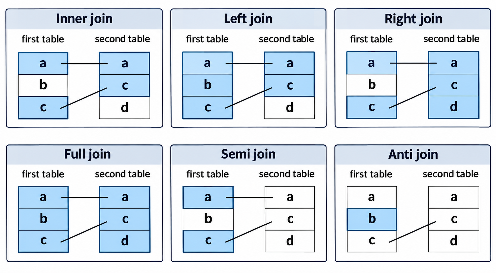

# Integración de datos y automatización de análisis en R

## Introducción

Ya vimos como **importar y explorar archivos**, y como **transformar una tabla** con `dplyr` y `tidyr`. Ahora resolveremos dos situaciones habituales al trabajar con datos:

1.  Tenemos una tabla con resultados y otra con información adicional. ¿Cómo relacionarlas sin perder registros?
2.  Tenemos varios archivos con la misma estructura. ¿Cómo procesarlos sin repetir el mismo código para cada archivo?

Seguiremos utilizando **resultados sintéticos con estructura de salida tabular de BLAST**. No ejecutaremos BLAST ni interpretaremos estos datos como resultados biológicos reales. Los umbrales utilizados serán ejemplos para practicar programación.

## Archivos de trabajo

Descarga y descomprime [`datos_sesion_04_integracion.zip`](https://github.com/CursosENESJuriquilla/Intro_to_R_Bioinfo_2027-1/raw/refs/heads/main/data/datos_sesion_04_integracion.zip) dentro de la carpeta `data_raw/` de tu proyecto de RStudio. La estructura esperada es:

``` text
mi_proyecto/
├── mi_proyecto.Rproj
├── data_raw/
│   └── datos_sesion_04_integracion/
│       ├── metadata_secuencias.csv
│       ├── metadata_duplicada.csv
│       ├── blast_muestras/
│       │   ├── muestra_A.tsv
│       │   ├── muestra_B.tsv
│       │   └── muestra_C.tsv
│       └── README.md
└── results/
```

La carpeta `results/` se utilizará para guardar los archivos que produzca nuestro código. **No sobrescribiremos los datos originales.**

Usaremos los paquetes `dplyr`, `readr` y, brevemente, `purrr`. Si no están instalados, se instalan una sola vez:

```{r}
#| eval: false
install.packages(c("dplyr", "readr", "purrr"))
```

Cargamos los paquetes que utilizaremos y definimos las rutas:

```{r}
library(dplyr)
library(readr)

getwd()

carpeta_datos <- "data_raw/datos_sesion_04_integracion"
carpeta_blast <- file.path(carpeta_datos, "blast_muestras")

if (!dir.exists("results")) {
  dir.create("results")
}
```

::: callout-note
## Sobre `%>%` y las rutas

En esta sesión utilizaremos `%>%` para encadenar transformaciones. La función `file.path()` construye rutas sin que tengamos que escribir manualmente el separador de carpetas. Recuerda ejecutar los ejemplos desde el proyecto de RStudio para que las rutas relativas funcionen.
:::

## Relaciones entre tablas: identificadores y correspondencias

Imaginemos que tenemos dos tablas. La primera contiene alineamientos; la segunda describe las secuencias de consulta.

```{r}
blast_A <- read_tsv(
  file.path(carpeta_blast, "muestra_A.tsv"),
  show_col_types = FALSE
)

metadata <- read_csv(
  file.path(carpeta_datos, "metadata_secuencias.csv"),
  col_types = cols(codigo_muestra = col_character(), .default = col_guess())
)

head(blast_A)
head(metadata)
```

- `cols()`: define los tipos de datos de las columnas.

- `codigo_muestra = col_character()`: obliga a que la columna codigo_muestra se importe como texto, incluso si contiene únicamente números. Esto permite conservar identificadores como "001" o "002" sin perder los ceros iniciales.

- `.default = col_guess()`: indica que, para todas las demás columnas, readr debe detectar automáticamente el tipo de dato.

La columna `query_id` aparece en ambas tablas. Por eso podemos utilizarla como **clave de unión**.

Una clave no necesariamente tiene que llamarse igual en las dos tablas, pero debe representar el mismo tipo de identificador. Por ejemplo, no sería correcto unir `query_id` con `subject_id` solamente porque ambos contienen texto.

### Relaciones de uno a uno y uno a muchos

En `metadata`, cada `query_id` identifica una sola fila. En los resultados de BLAST, una misma consulta puede aparecer varias veces porque tiene varios alineamientos.

Por tanto, al relacionar resultados de BLAST con metadatos tenemos, en principio, una relación de **muchos a uno**: varios alineamientos pueden corresponder a una sola secuencia de consulta.

```{r}
metadata %>%
  count(query_id) %>%
  arrange(desc(n))

blast_A %>%
  count(query_id) %>%
  arrange(desc(n))
```

La función `count()` cuenta filas para cada valor de la columna indicada. En la sesión 3 vimos que es equivalente a una combinación de `group_by()` y `summarise(n = n())`.

### ¿Qué ocurre cuando no hay correspondencia?

En los datos de práctica:

- `seq09` aparece en los resultados de la muestra C, pero no en los metadatos.
- `seq10` aparece en los metadatos, pero no tiene resultados de BLAST en las muestras.

Esto nos permitirá observar cómo se comportan las distintas uniones.

## Combinar tablas mediante `dplyr`

Una **unión** (*join*) combina columnas de dos tablas a partir de los valores de una o varias claves. En la @fig-tipos-join se muestran los principales tipos de uniones disponibles en `dplyr`, así como las diferencias entre las observaciones que conserva cada operación.

{#fig-tipos-join width="95%" fig-align="center"}

### `left_join()`: conservar la tabla de la izquierda

`left_join(x, y, by = "query_id")` conserva todas las filas de `x` y añade la información coincidente de `y`.

```{r}
blast_A_con_metadata <- blast_A %>%
  left_join(metadata, by = "query_id")

blast_A_con_metadata %>%
  select(query_id, subject_id, pident, organismo, origen) %>%
  head()
```

Observa que una secuencia con varios alineamientos recibe la misma información de metadatos en cada fila correspondiente. Esto es esperado: **no significa que se hayan duplicado accidentalmente los alineamientos**.

### `inner_join()`: conservar solo las correspondencias

`inner_join()` conserva únicamente las filas que tienen una clave coincidente en ambas tablas.

Para comparar mejor las funciones, leeremos también la muestra C, que contiene `seq09`:

```{r}
blast_C <- read_tsv(
  file.path(carpeta_blast, "muestra_C.tsv"),
  show_col_types = FALSE
)

nrow(blast_C)

blast_C %>%
  inner_join(metadata, by = "query_id") %>%
  nrow()
```

El resultado puede tener menos filas que la tabla original: las filas sin correspondencia quedan fuera.

### `anti_join()`: encontrar identificadores sin correspondencia

`anti_join(x, y, by = "query_id")` devuelve las filas de `x` que **no encuentran una coincidencia** en `y`.

```{r}
blast_C %>%
  anti_join(metadata, by = "query_id")
```

También podemos invertir el orden para identificar metadatos sin resultados en esta muestra:

```{r}
metadata %>%
  anti_join(blast_C, by = "query_id")
```

::: callout-important
## El orden de las tablas importa

En `left_join()` y `anti_join()`, intercambiar `x` e `y` cambia la pregunta. No es lo mismo preguntar «¿qué resultados carecen de metadatos?» que «¿qué secuencias de los metadatos no tienen resultados?».
:::

### `full_join()`: conservar las filas de ambas tablas

`full_join()` incluye tanto las coincidencias como las filas sin correspondencia de cualquiera de las tablas.

```{r}
blast_C %>%
  full_join(metadata, by = "query_id") %>%
  select(query_id, subject_id, organismo) %>%
  arrange(query_id)
```

Cuando una fila no tiene información de la otra tabla, las columnas correspondientes contienen `NA`.

| Función | ¿Qué filas conserva? | Uso típico |
|------------------------|------------------------|------------------------|
| `left_join(x, y)` | Todas las de `x` y sus coincidencias en `y` | Agregar metadatos a resultados |
| `inner_join(x, y)` | Solo las que coinciden en ambas | Trabajar con registros compartidos |
| `anti_join(x, y)` | Las de `x` sin coincidencia en `y` | Encontrar identificadores sin información asociada |
| `full_join(x, y)` | Todas las de `x` y de `y` | Explorar el conjunto completo de identificadores |

### Un detalle importante: claves repetidas

¿Qué sucede si la tabla de metadatos contiene más de una fila para un mismo `query_id`?

```{r}
metadata_duplicada <- read_csv(
  file.path(carpeta_datos, "metadata_duplicada.csv"),
  col_types = cols(codigo_muestra = col_character(), .default = col_guess())
)

metadata_duplicada %>%
  count(query_id)
```

En esta tabla, `seq01` aparece dos veces. Al unirla con `blast_A`, cada alineamiento de `seq01` encontrará **dos coincidencias**, y por ello producirá dos filas en el resultado:

```{r}
nrow(blast_A)

blast_A %>%
  left_join(metadata_duplicada, by = "query_id") %>%
  nrow()
```

No debemos resolver esto eliminando duplicados automáticamente: primero necesitamos comprender por qué existen. Quizá la clave elegida no identifica de forma única los registros, o quizá se requiere una clave compuesta.

Antes de una unión en la que esperamos **una fila por identificador** en los metadatos, podemos comprobarlo:

```{r}
metadata %>%
  count(query_id) %>%
  filter(n > 1)
```

Una tabla vacía indica que no se encontraron identificadores repetidos.

## Apilar resultados de distintas muestras

Hasta ahora hemos relacionado tablas que contienen **información diferente** sobre los mismos identificadores. Ahora tenemos otro problema: varios archivos con **las mismas columnas**, pero con registros diferentes.

En este caso no queremos añadir columnas mediante una clave; queremos **apilar filas**.

### `bind_rows()`

```{r}
blast_B <- read_tsv(
  file.path(carpeta_blast, "muestra_B.tsv"),
  show_col_types = FALSE
)

blast_total <- bind_rows(
  muestra_A = blast_A,
  muestra_B = blast_B,
  muestra_C = blast_C,
  .id = "muestra"
)

blast_total %>%
  count(muestra)
```

El argumento `.id = "muestra"` crea una columna que indica de qué archivo proviene cada registro. Esto es importante: si perdemos la procedencia de los registros, después podría resultar difícil interpretar los resultados.

```{r}
blast_total %>%
  select(muestra, query_id, subject_id, pident) %>%
  head()
```

### Diferencia entre `bind_rows()` y un `join`

- `bind_rows()` coloca una tabla debajo de otra. Se usa cuando las columnas representan la misma información.
- `left_join()` y otras uniones relacionan tablas mediante claves y agregan columnas.

En esta sesión no necesitaremos `bind_cols()`: unir columnas por posición puede producir correspondencias equivocadas si las filas no están perfectamente alineadas.

## Funciones: escribir una operación una sola vez

En la sesión 1 aprendimos a escribir funciones. Aquí las recuperamos para que una transformación pueda repetirse con distintos argumentos. Por ejemplo, al trabajar con resultados de BLAST podemos cambiar el umbral sin reescribir el procedimiento:

```{r}
filtrar_alineamientos <- function(tabla, identidad_minima = 90) {
  tabla %>%
    filter(pident >= identidad_minima) %>%
    arrange(desc(bitscore))
}

filtrar_alineamientos(blast_A)
filtrar_alineamientos(blast_B, identidad_minima = 95)
```

`tabla` es la entrada; `identidad_minima` es un argumento configurable, con valor predeterminado; la última expresión es el resultado devuelto. **Automatizar no exige introducir nuevas funciones complejas:** puede consistir en hacer reutilizable un procedimiento que ya sabemos realizar.

::: callout-note
## Una herramienta para reconocer, no para memorizar

Si en otro proyecto tenemos rutas como `archivos_blast`, podemos obtener nombres de archivo sin ruta ni extensión con:

```{r}
#| eval: false
tools::file_path_sans_ext(basename(archivos_blast))
```

`basename()` conserva el nombre final de la ruta y `tools::file_path_sans_ext()` elimina la extensión. Existen además herramientas como `lapply()` y `purrr::map()` para aplicar funciones a varios objetos, pero **no las desarrollaremos en esta sesión**.
:::

## Datos reales de rizosfera: del archivo a la tabla

Trabajaremos con **un subconjunto de datos reales del proyecto [MicroAgroBiome](https://agrobiom.matmor.unam.mx/)**. Contamos con 75 muestras y una tabla de conteos de 3,330 registros taxonómicos. Los archivos fueron organizados en formatos de texto para facilitar su uso en R.

Los conteos son observaciones de secuenciación, no mediciones directas del número de microorganismos. Además, las muestras provienen de distintos estudios, por lo que las diferencias entre hospederos no pueden atribuirse únicamente a la especie de planta.

Descarga [`datos_rizosfera.zip`](https://github.com/CursosENESJuriquilla/Intro_to_R_Bioinfo_2027-1/raw/refs/heads/main/data/datos_rizosfera.zip) y descomprímelo dentro de `data_raw/`:

``` text
mi_proyecto/
├── mi_proyecto.Rproj
├── data_raw/
│   ├── datos_sesion_04_integracion/    
│   └── datos_rizosfera/
│       ├── conteos_taxonomia_rizosfera.tsv
│       └── metadata_rizosfera.csv
└── results/
```

### Importar e inspeccionar

```{r}
library(dplyr)
library(readr)
library(tidyr)

carpeta_rizosfera <- "data_raw/datos_rizosfera"

conteos_riz <- read_tsv(
  file.path(carpeta_rizosfera, "conteos_taxonomia_rizosfera.tsv"),
  show_col_types = FALSE
)

metadata_riz <- read_csv(
  file.path(carpeta_rizosfera, "metadata_rizosfera.csv"),
  show_col_types = FALSE
)

dim(conteos_riz)
glimpse(conteos_riz)
head(conteos_riz[, 1:9], 3)

metadata_riz %>%
  count(host_name, sort = TRUE)
```

En `conteos_riz`, **cada fila corresponde a un registro taxonómico**; las primeras columnas describen su clasificación y las columnas `SRR...` o `ERR...` corresponden a muestras. En `metadata_riz`, **cada fila describe una muestra** mediante `sample_id` y otras variables, como `host_name`.

Los prefijos de la clasificación indican el nivel taxonómico: `k__` (reino), `p__` (filo), `c__` (clase), `o__` (orden), `f__` (familia), `g__` (género) y `s__` (especie). Algunos registros no tienen asignación en todos los niveles.

### Limpiar los valores taxonómicos

Queremos conservar nombres como `Bacteria`, `Bacillota` y `Lactobacillus`, sin sus prefijos. Las columnas ya se llaman `kingdom`, `phylum`, `class`, `order`, `family`, `genus` y `species`.

```{r}
niveles <- c(
  "kingdom", "phylum", "class", "order",
  "family", "genus", "species"
)

conteos_limpios <- conteos_riz %>%
  mutate(
    across(
      all_of(niveles),
      ~ na_if(sub("^[a-z]__", "", .x), "")
    )
  )

conteos_limpios %>%
  select(taxon_id, all_of(niveles)) %>%
  head()
```

- `sub()` elimina el prefijo al inicio del texto.
- `across()` aplica la misma transformación a las siete columnas.
- `na_if(..., "")` convierte las asignaciones vacías en `NA`: **sin clasificar no significa que el taxón no exista**.

### Transformar a formato largo e incorporar metadatos

Las columnas de muestras están en formato ancho. Recuperamos `pivot_longer()` para obtener una fila por combinación de registro taxonómico y muestra. Seleccionamos las columnas de muestras utilizando los identificadores de los metadatos, en lugar de depender de una lista de nombres escrita a mano.

```{r}
ids_muestras <- metadata_riz$sample_id

stopifnot(
  !anyDuplicated(ids_muestras),
  all(ids_muestras %in% names(conteos_limpios))
)

conteos_largos <- conteos_limpios %>%
  pivot_longer(
    cols = all_of(ids_muestras),
    names_to = "sample_id",
    values_to = "conteo"
  )

datos_riz <- conteos_largos %>%
  left_join(
    metadata_riz %>% select(sample_id, host_name, country, year),
    by = "sample_id",
    relationship = "many-to-one"
  )

glimpse(datos_riz)
```

¿Por qué `many-to-one`? Porque una muestra aparece en muchas filas de conteos, pero debe tener **una sola fila de metadatos**. Verificamos si hubo muestras sin correspondencia:

```{r}
conteos_largos %>%
  anti_join(metadata_riz, by = "sample_id") %>%
  distinct(sample_id)
```

Si el resultado de `anti_join()` no contiene filas, significa que **todas las muestras de la tabla de conteos tienen un identificador correspondiente en la tabla de metadatos**.

Antes de continuar, necesitamos realizar otra comprobación: verificar que cada muestra tenga conteos suficientes para calcular sus abundancias relativas.

Para ello, agrupamos los datos por `sample_id` y sumamos los conteos de todos los taxones de cada muestra. Esta suma representa el total de lecturas contabilizadas en nuestra tabla para esa muestra.

La instrucción `stopifnot()` verifica que todos estos totales sean mayores que cero. Si alguna muestra tuviera un total igual a cero, no podríamos calcular sus abundancias relativas dividiendo entre ese total.

Esta comprobación es importante porque **en el siguiente paso calcularemos la proporción que representa cada taxón respecto al total de su muestra**.

```{r}
totales_muestra <- datos_riz %>%
  group_by(sample_id) %>%
  summarise(total_lecturas = sum(conteo), .groups = "drop")

stopifnot(all(totales_muestra$total_lecturas > 0))
head(totales_muestra)
```

Y lo guardamos porque lo vamos a usar en la sesión de plots.

```{r}
write_tsv(totales_muestra, "results/totales_muestra.tsv")
```

### Calcular abundancia relativa correctamente

**La abundancia relativa se calcula dentro de cada muestra**. Para estudiar géneros, primero reunimos los conteos de todos los registros asignados al mismo género; después dividimos entre el total de conteos de esa muestra. Los registros sin asignación de género se mantienen como `Sin clasificar` para no alterar el denominador.

```{r}
abundancias_genero <- datos_riz %>%
  mutate(genus = if_else(is.na(genus), "Sin clasificar", genus)) %>%
  group_by(sample_id, host_name, genus) %>%
  summarise(conteo = sum(conteo), .groups = "drop") %>%
  group_by(sample_id) %>%
  mutate(abundancia_relativa = conteo / sum(conteo)) %>%
  ungroup()

abundancias_genero %>%
  select(sample_id, host_name, genus, conteo, abundancia_relativa) %>%
  head()
```

Si una muestra tiene 1,000 conteos y 80 pertenecen a un género, su abundancia relativa es `80 / 1000 = 0.08`, es decir, 8 %. No estamos calculando una proporción conjunta de todas las muestras ni promediando muestras todavía.

### Agrupar los géneros por debajo del 5 %

Para facilitar la lectura de una gráfica de diversidad, conservaremos por separado los géneros cuya abundancia relativa **en esa muestra** sea al menos 5 %. Los géneros con menos de 5 % se sumarán en `Otros`. Dejaremos `Sin clasificar` como categoría propia, incluso si representa menos del umbral.

```{r}
generos_5 <- abundancias_genero %>%
  mutate(
    taxon_final = if_else(
      genus != "Sin clasificar" & abundancia_relativa < 0.05,
      "Otros",
      genus
    )
  ) %>%
  group_by(sample_id, host_name, taxon_final) %>%
  summarise(
    abundancia_relativa = sum(abundancia_relativa),
    .groups = "drop"
  )

# Cada muestra debe sumar 1 (salvo pequeñas diferencias numéricas).
comprobacion <- generos_5 %>%
  group_by(sample_id) %>%
  summarise(total = sum(abundancia_relativa), .groups = "drop")

stopifnot(all(abs(comprobacion$total - 1) < 1e-8))
head(comprobacion)
```

Un género puede superar el umbral en una muestra y quedar dentro de `Otros` en otra.

### Automatizar el análisis para distintos niveles taxonómicos

Ya sabemos realizar la transformación. Ahora la convertimos en una función que recibe el **nivel taxonómico** y el **umbral**, de modo que no tengamos que copiar todo el procedimiento para filo, familia, género, etc.

```{r}
preparar_abundancias <- function(tabla, nivel = "genus", umbral = 0.05) {
  niveles_validos <- c(
    "kingdom", "phylum", "class", "order",
    "family", "genus", "species"
  )

  stopifnot(
    nivel %in% niveles_validos,
    is.numeric(umbral), length(umbral) == 1,
    !is.na(umbral), umbral >= 0, umbral <= 1
  )
  
  etiqueta_otros <- if (nivel == "phylum") {
    "Filos < 5%"
  } else if (nivel == "genus") {
    "Géneros < 5%"
  } else {
    "Taxones < 5%"
  }

  tabla %>%
    mutate(
      taxon = .data[[nivel]],
      taxon = if_else(is.na(taxon) | taxon == "",
                      "Sin clasificar", taxon)
    ) %>%
    group_by(sample_id, host_name, taxon) %>%
    summarise(conteo = sum(conteo), .groups = "drop") %>%
    group_by(sample_id) %>%
    mutate(abundancia_relativa = conteo / sum(conteo)) %>%
    ungroup() %>%
    mutate(
      taxon_final = if_else(
        abundancia_relativa < umbral,
        etiqueta_otros,
        taxon
      )
    ) %>%
    group_by(sample_id, host_name, taxon_final) %>%
    summarise(
      abundancia_relativa = sum(abundancia_relativa),
      .groups = "drop"
    )
}
```

Probamos la misma función con diferentes preguntas:

```{r}
generos_5 <- preparar_abundancias(datos_riz, "genus", 0.05)
filos_5 <- preparar_abundancias(datos_riz, "phylum", 0.05)
familias_1 <- preparar_abundancias(datos_riz, "family", 0.01)

filos_5 %>% head()
```

El resultado tiene una fila por **muestra y categoría taxonómica final**, con su abundancia relativa. Es un formato largo adecuado para graficar barras apiladas y facetas. Si necesitáramos un formato ancho, podríamos utilizar `pivot_wider()`.

Guardamos las tablas sin sobrescribir los datos de entrada:

```{r}
write_tsv(generos_5, "results/generos_5.tsv")
write_tsv(filos_5, "results/filos_5.tsv")
write_tsv(familias_1, "results/familias_1.tsv")
```

### Documentación de funciones

Cuando escribimos una función que utilizaremos varias veces, es importante documentar qué hace, qué argumentos recibe y qué devuelve.

En R, una forma habitual de documentar funciones es utilizar comentarios que comienzan con `#'`. Este formato es utilizado por el paquete `roxygen2` para generar documentación de funciones en paquetes de R.

Aunque aquí no estamos construyendo un paquete, podemos utilizar este estilo para mantener nuestro código organizado y comprensible.

Los elementos principales son:

- **Descripción:** explica qué hace la función.
- **`@param`:** describe cada argumento.
- **`@return`:** indica qué tipo de resultado devuelve.
- **`@examples`:** muestra cómo utilizar la función.

La documentación no modifica el funcionamiento de la función: sirve para que otras personas, o nosotros mismos en el futuro, podamos comprenderla y reutilizarla.

### Ejemplo de la misma función documentada

```{r}
#| eval: false
#| include: false
#' Preparar abundancias relativas por nivel taxonómico
#'
#' Agrupa los conteos de una comunidad microbiana según el nivel
#' taxonómico seleccionado, calcula abundancias relativas por muestra
#' y reúne los taxones poco abundantes en la categoría "Otros".
#'
#' Los taxones sin asignación se conservan como "Sin clasificar".
#'
#' @param tabla Tabla con las columnas sample_id, host_name,
#'   conteo y las columnas de clasificación taxonómica.
#' @param nivel Nivel taxonómico que se desea analizar.
#'   Puede ser "kingdom", "phylum", "class", "order",
#'   "family", "genus" o "species".
#' @param umbral Abundancia relativa mínima para conservar
#'   un taxón individualmente. Por defecto, 0.05 (5%).
#'
#' @return Una tabla con las columnas sample_id, host_name,
#'   taxon_final y abundancia_relativa.
#'   Las abundancias relativas suman 1 dentro de cada muestra.
#'
#' @examples
#' generos_5 <- preparar_abundancias(datos_riz, "genus", 0.05)
#' filos_1 <- preparar_abundancias(datos_riz, "phylum", 0.01)

preparar_abundancias <- function(tabla, nivel = "genus", umbral = 0.05) {

  # Verificar que los argumentos sean válidos
  niveles_validos <- c(
    "kingdom", "phylum", "class", "order",
    "family", "genus", "species"
  )

  stopifnot(
    nivel %in% niveles_validos,
    is.numeric(umbral), length(umbral) == 1,
    !is.na(umbral), umbral >= 0, umbral <= 1
  )
  
  etiqueta_otros <- if (nivel == "phylum") {
    "Filos < 5%"
  } else if (nivel == "genus") {
    "Géneros < 5%"
  } else {
    "Taxones < 5%"
  }

  tabla %>%

    # Seleccionar el nivel taxonómico
    mutate(
      taxon = .data[[nivel]],
      taxon = if_else(
        is.na(taxon) | taxon == "",
        "Sin clasificar", taxon
      )
    ) %>%

    # Sumar los conteos por taxón y muestra
    group_by(sample_id, host_name, taxon) %>%
    summarise(
      conteo = sum(conteo),
      .groups = "drop"
    ) %>%

    # Calcular abundancias relativas dentro de cada muestra
    group_by(sample_id) %>%
    mutate(
      abundancia_relativa = conteo / sum(conteo)
    ) %>%
    ungroup() %>%

    # Agrupar los taxones menos abundantes en "Otros"
    mutate(
      taxon_final = if_else(
       abundancia_relativa < umbral,
        etiqueta_otros, taxon
      )
    ) %>%

    # Sumar las abundancias de los taxones agrupados
    group_by(sample_id, host_name, taxon_final) %>%
    summarise(
      abundancia_relativa = sum(abundancia_relativa),
      .groups = "drop"
    )
}
```

## Actividad breve: ¿la tabla está lista para graficarse?


:::: {.callout-warning icon="false"}
## 🧠 Ejercicio

Documentar la función.

::::

:::: {.callout-warning icon="false"}
## 🧠 Ejercicio

Sin construir otra función, revisa `generos_5` y responde:

1.  ¿Qué representa una fila de `generos_5`?
2.  ¿Por qué un mismo género puede aparecer individualmente en una muestra y dentro de `Otros` en otra?
3.  Si construimos una gráfica de barras apiladas al 100 %, ¿cuánto deben sumar las abundancias relativas de cada muestra? Compruébalo con `group_by()` y `summarise()`.
4.  ¿Qué columna nos permite comparar las muestras según la planta hospedera? ¿De dónde proviene?

::: {.callout-tip collapse="true" icon="false"}
## Solución y discusión

1.  Una combinación de muestra (`sample_id`), hospedero (`host_name`) y categoría taxonómica final (`taxon_final`), con su abundancia relativa.
2.  Porque el umbral se aplica **dentro de cada muestra**: la proporción del género puede ser distinta entre muestras.
3.  Deben sumar **1**, equivalente al 100 %:

```{r}
generos_5 %>%
  group_by(sample_id) %>%
  summarise(total = sum(abundancia_relativa), .groups = "drop")
```

4.  `host_name`, incorporada desde el archivo de metadatos mediante `left_join()`.
:::
::::
