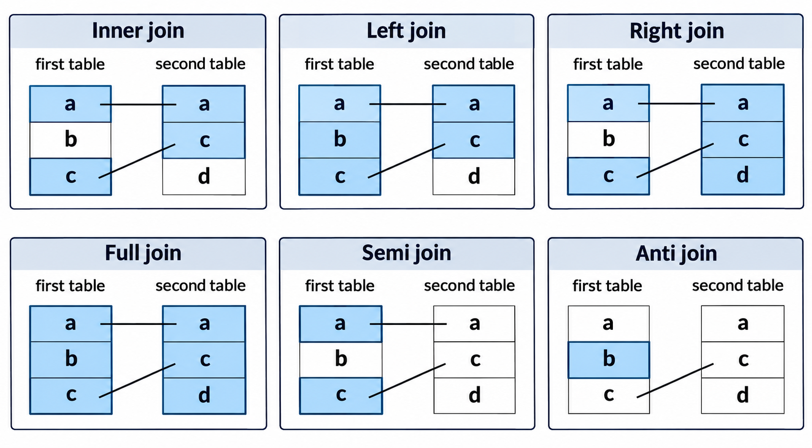

# Integración de datos y automatización de análisis en R

## Introducción

Ya vimos como **importar y explorar archivos**, y como **transformar una tabla** con `dplyr` y `tidyr`. Ahora resolveremos dos situaciones habituales al trabajar con datos:

1.  Tenemos una tabla con resultados y otra con información adicional. ¿Cómo relacionarlas sin perder registros?
2.  Tenemos varios archivos con la misma estructura. ¿Cómo procesarlos sin repetir el mismo código para cada archivo?

Seguiremos utilizando **resultados sintéticos con estructura de salida tabular de BLAST**. No ejecutaremos BLAST ni interpretaremos estos datos como resultados biológicos reales. Los umbrales utilizados serán ejemplos para practicar programación.


## Archivos de trabajo

Descarga y descomprime [`datos_sesion_04_integracion.zip`](https://github.com/CursosENESJuriquilla/Intro_to_R_Bioinfo_2027-1/raw/refs/heads/main/data/datos_sesion_04_integracion.zip) dentro de la carpeta `data_raw/` de tu proyecto de RStudio. La estructura esperada es:

``` text
mi_proyecto/
├── mi_proyecto.Rproj
├── data_raw/
│   └── datos_sesion_04_integracion/
│       ├── metadata_secuencias.csv
│       ├── metadata_duplicada.csv
│       ├── blast_muestras/
│       │   ├── muestra_A.tsv
│       │   ├── muestra_B.tsv
│       │   └── muestra_C.tsv
│       └── README.md
└── results/
```

La carpeta `results/` se utilizará para guardar los archivos que produzca nuestro código. **No sobrescribiremos los datos originales.**

Usaremos los paquetes `dplyr`, `readr` y, brevemente, `purrr`. Si no están instalados, se instalan una sola vez:

```{r}
#| eval: false
install.packages(c("dplyr", "readr", "purrr"))
```

Cargamos los paquetes que utilizaremos y definimos las rutas:

```{r}
library(dplyr)
library(readr)

getwd()

carpeta_datos <- "data_raw/datos_sesion_04_integracion"
carpeta_blast <- file.path(carpeta_datos, "blast_muestras")

if (!dir.exists("results")) {
  dir.create("results")
}
```

::: callout-note
## Sobre `%>%` y las rutas

En esta sesión utilizaremos `%>%` para encadenar transformaciones. La función `file.path()` construye rutas sin que tengamos que escribir manualmente el separador de carpetas. Recuerda ejecutar los ejemplos desde el proyecto de RStudio para que las rutas relativas funcionen.
:::

## Relaciones entre tablas: identificadores y correspondencias

Imaginemos que tenemos dos tablas. La primera contiene alineamientos; la segunda describe las secuencias de consulta.

```{r}
blast_A <- read_tsv(
  file.path(carpeta_blast, "muestra_A.tsv"),
  show_col_types = FALSE
)

metadata <- read_csv(
  file.path(carpeta_datos, "metadata_secuencias.csv"),
  col_types = cols(codigo_muestra = col_character(), .default = col_guess())
)

head(blast_A)
head(metadata)
```


- `cols()`: define los tipos de datos de las columnas.

- `codigo_muestra = col_character()`: obliga a que la columna codigo_muestra se importe como texto, incluso si contiene únicamente números. Esto permite conservar identificadores como "001" o "002" sin perder los ceros iniciales.

- `.default = col_guess()`: indica que, para todas las demás columnas, readr debe detectar automáticamente el tipo de dato.

La columna `query_id` aparece en ambas tablas. Por eso podemos utilizarla como **clave de unión**.

Una clave no necesariamente tiene que llamarse igual en las dos tablas, pero debe representar el mismo tipo de identificador. Por ejemplo, no sería correcto unir `query_id` con `subject_id` solamente porque ambos contienen texto.

### Relaciones de uno a uno y uno a muchos

En `metadata`, cada `query_id` identifica una sola fila. En los resultados de BLAST, una misma consulta puede aparecer varias veces porque tiene varios alineamientos.

Por tanto, al relacionar resultados de BLAST con metadatos tenemos, en principio, una relación de **muchos a uno**: varios alineamientos pueden corresponder a una sola secuencia de consulta.

```{r}
metadata %>%
  count(query_id) %>%
  arrange(desc(n))

blast_A %>%
  count(query_id) %>%
  arrange(desc(n))
```

La función `count()` cuenta filas para cada valor de la columna indicada. En la sesión 3 vimos que es equivalente a una combinación de `group_by()` y `summarise(n = n())`.

### ¿Qué ocurre cuando no hay correspondencia?

En los datos de práctica:

- `seq09` aparece en los resultados de la muestra C, pero no en los metadatos.
- `seq10` aparece en los metadatos, pero no tiene resultados de BLAST en las muestras.

Esto nos permitirá observar cómo se comportan las distintas uniones.

## Combinar tablas mediante `dplyr`

Una **unión** (*join*) combina columnas de dos tablas a partir de los valores de una o varias claves. En la @fig-tipos-join se muestran los principales tipos de uniones disponibles en `dplyr`, así como las diferencias entre las observaciones que conserva cada operación.


{#fig-tipos-join width="95%" fig-align="center"}


### `left_join()`: conservar la tabla de la izquierda

`left_join(x, y, by = "query_id")` conserva todas las filas de `x` y añade la información coincidente de `y`.

```{r}
blast_A_con_metadata <- blast_A %>%
  left_join(metadata, by = "query_id")

blast_A_con_metadata %>%
  select(query_id, subject_id, pident, organismo, origen) %>%
  head()
```

Observa que una secuencia con varios alineamientos recibe la misma información de metadatos en cada fila correspondiente. Esto es esperado: **no significa que se hayan duplicado accidentalmente los alineamientos**.

### `inner_join()`: conservar solo las correspondencias

`inner_join()` conserva únicamente las filas que tienen una clave coincidente en ambas tablas.

Para comparar mejor las funciones, leeremos también la muestra C, que contiene `seq09`:

```{r}
blast_C <- read_tsv(
  file.path(carpeta_blast, "muestra_C.tsv"),
  show_col_types = FALSE
)

nrow(blast_C)

blast_C %>%
  inner_join(metadata, by = "query_id") %>%
  nrow()
```

El resultado puede tener menos filas que la tabla original: las filas sin correspondencia quedan fuera.

### `anti_join()`: encontrar identificadores sin correspondencia

`anti_join(x, y, by = "query_id")` devuelve las filas de `x` que **no encuentran una coincidencia** en `y`.

```{r}
blast_C %>%
  anti_join(metadata, by = "query_id")
```

También podemos invertir el orden para identificar metadatos sin resultados en esta muestra:

```{r}
metadata %>%
  anti_join(blast_C, by = "query_id")
```

::: callout-important
## El orden de las tablas importa

En `left_join()` y `anti_join()`, intercambiar `x` e `y` cambia la pregunta. No es lo mismo preguntar «¿qué resultados carecen de metadatos?» que «¿qué secuencias de los metadatos no tienen resultados?».
:::

### `full_join()`: conservar las filas de ambas tablas

`full_join()` incluye tanto las coincidencias como las filas sin correspondencia de cualquiera de las tablas.

```{r}
blast_C %>%
  full_join(metadata, by = "query_id") %>%
  select(query_id, subject_id, organismo) %>%
  arrange(query_id)
```

Cuando una fila no tiene información de la otra tabla, las columnas correspondientes contienen `NA`.

| Función | ¿Qué filas conserva? | Uso típico |
|------------------------|------------------------|------------------------|
| `left_join(x, y)` | Todas las de `x` y sus coincidencias en `y` | Agregar metadatos a resultados |
| `inner_join(x, y)` | Solo las que coinciden en ambas | Trabajar con registros compartidos |
| `anti_join(x, y)` | Las de `x` sin coincidencia en `y` | Encontrar identificadores sin información asociada |
| `full_join(x, y)` | Todas las de `x` y de `y` | Explorar el conjunto completo de identificadores |

### Un detalle importante: claves repetidas

¿Qué sucede si la tabla de metadatos contiene más de una fila para un mismo `query_id`?

```{r}
metadata_duplicada <- read_csv(
  file.path(carpeta_datos, "metadata_duplicada.csv"),
  col_types = cols(codigo_muestra = col_character(), .default = col_guess())
)

metadata_duplicada %>%
  count(query_id)
```

En esta tabla, `seq01` aparece dos veces. Al unirla con `blast_A`, cada alineamiento de `seq01` encontrará **dos coincidencias**, y por ello producirá dos filas en el resultado:

```{r}
nrow(blast_A)

blast_A %>%
  left_join(metadata_duplicada, by = "query_id") %>%
  nrow()
```

No debemos resolver esto eliminando duplicados automáticamente: primero necesitamos comprender por qué existen. Quizá la clave elegida no identifica de forma única los registros, o quizá se requiere una clave compuesta.

Antes de una unión en la que esperamos **una fila por identificador** en los metadatos, podemos comprobarlo:

```{r}
metadata %>%
  count(query_id) %>%
  filter(n > 1)
```

Una tabla vacía indica que no se encontraron identificadores repetidos.


## Apilar resultados de distintas muestras

Hasta ahora hemos relacionado tablas que contienen **información diferente** sobre los mismos identificadores. Ahora tenemos otro problema: varios archivos con **las mismas columnas**, pero con registros diferentes.

En este caso no queremos añadir columnas mediante una clave; queremos **apilar filas**.

### `bind_rows()`

```{r}
blast_B <- read_tsv(
  file.path(carpeta_blast, "muestra_B.tsv"),
  show_col_types = FALSE
)

blast_total <- bind_rows(
  muestra_A = blast_A,
  muestra_B = blast_B,
  muestra_C = blast_C,
  .id = "muestra"
)

blast_total %>%
  count(muestra)
```

El argumento `.id = "muestra"` crea una columna que indica de qué archivo proviene cada registro. Esto es importante: si perdemos la procedencia de los registros, después podría resultar difícil interpretar los resultados.

```{r}
blast_total %>%
  select(muestra, query_id, subject_id, pident) %>%
  head()
```

### Diferencia entre `bind_rows()` y un `join`

- `bind_rows()` coloca una tabla debajo de otra. Se usa cuando las columnas representan la misma información.
- `left_join()` y otras uniones relacionan tablas mediante claves y agregan columnas.

En esta sesión no necesitaremos `bind_cols()`: unir columnas por posición puede producir correspondencias equivocadas si las filas no están perfectamente alineadas.


## Funciones para automatizar transformaciones

En la sesión 1 aprendimos a escribir funciones. Ahora las utilizaremos para aplicar el mismo conjunto de operaciones a distintas tablas.

Supongamos que queremos conservar alineamientos con una identidad mínima y ordenarlos por puntuación.

Sin una función tendríamos que repetir el mismo bloque de instrucciones para cada muestra. En su lugar, definimos una función que reciba la tabla y el umbral:

```{r}
filtrar_alineamientos <- function(datos, identidad_minima = 90) {
  datos %>%
    filter(pident >= identidad_minima) %>%
    arrange(desc(bitscore))
}
```

- `datos` es el argumento que recibe una tabla.
- `identidad_minima = 90` define un valor predeterminado.
- La última expresión de la función es la tabla que se devuelve.

```{r}
filtrar_alineamientos(blast_A)

filtrar_alineamientos(blast_B, identidad_minima = 95)
```

Podemos crear funciones que produzcan resúmenes:

```{r}
resumir_alineamientos <- function(datos) {
  datos %>%
    group_by(query_id) %>%
    summarise(
      numero_alineamientos = n(),
      bitscore_maximo = max(bitscore, na.rm = TRUE),
      .groups = "drop"
    )
}

resumir_alineamientos(blast_A)
```

::: callout-note
## ¿Qué significa automatizar aquí?

No significa necesariamente construir un programa complicado. Automatizar consiste en **escribir una operación una sola vez** para poder aplicarla de manera consistente a diferentes entradas.
:::


## Procesar múltiples archivos

Imagina que en lugar de tres muestras tenemos treinta. Importarlas una por una sería tedioso y aumentaría la probabilidad de cometer errores.

Podemos construir un procedimiento que descubra los archivos, los lea y combine los resultados.

### Localizar archivos con `list.files()`

```{r}
archivos_blast <- list.files(
  path = carpeta_blast,
  pattern = "\\.tsv$",
  full.names = TRUE
)

archivos_blast
```

El argumento `pattern` selecciona nombres que terminan en `.tsv`. La expresión `\\.tsv$` utiliza una expresión regular sencilla:

- `\\.` representa un punto literal.
- `tsv` son las letras que buscamos.
- `$` indica el final del nombre.

Con `full.names = TRUE`, obtenemos rutas que podemos pasar directamente a las funciones de lectura.

### Leer todos los archivos con `lapply()`

`lapply()` recibe una lista o vector y una función. Aplica la función a cada elemento y devuelve una **lista**.

```{r}
lista_blast <- lapply(
  archivos_blast,
  function(archivo) {
    read_tsv(archivo, show_col_types = FALSE)
  }
)

length(lista_blast)
names(lista_blast)
```

En este momento `lista_blast` contiene tres tablas, pero sus elementos todavía no tienen nombres descriptivos.

```{r}
nombres_muestras <- tools::file_path_sans_ext(
  basename(archivos_blast)
)

names(lista_blast) <- nombres_muestras

names(lista_blast)
```

- `basename()` extrae el nombre del archivo sin su ruta.
- `tools::file_path_sans_ext()` elimina la extensión.
- `names()` asigna esos nombres a los elementos de la lista.

Podemos acceder a una tabla por su nombre:

```{r}
head(lista_blast[["muestra_A"]])
```

### Combinar las tablas de la lista

```{r}
blast_todos_archivos <- bind_rows(
  lista_blast,
  .id = "muestra"
)

blast_todos_archivos %>%
  count(muestra)
```

Esta solución funciona aunque agreguemos más archivos TSV con las mismas columnas a la carpeta. **La condición es que todos tengan una estructura compatible**.

### Aplicar nuestra función a todos los archivos

Podemos utilizar `lapply()` para aplicar `filtrar_alineamientos()` a cada tabla:

```{r}
lista_filtrada <- lapply(
  lista_blast,
  filtrar_alineamientos,
  identidad_minima = 90,
  longitud_minima = 100
)

blast_filtrado <- bind_rows(
  lista_filtrada,
  .id = "muestra"
)

blast_filtrado %>%
  count(muestra)
```

Observa que no escribimos tres llamadas distintas a nuestra función: `lapply()` se encarga de repetirla para cada elemento.

### Una alternativa con `purrr::map()`

El paquete `purrr` ofrece herramientas para trabajar con listas. Su función `map()` cumple un propósito parecido al de `lapply()`:

```{r}
library(purrr)

lista_filtrada_map <- map(
  lista_blast,
  filtrar_alineamientos,
  identidad_minima = 90,
  longitud_minima = 100
)

blast_filtrado_map <- bind_rows(
  lista_filtrada_map,
  .id = "muestra"
)
```

No necesitamos aprender todas las variantes de `map()` en esta sesión. Lo importante es reconocer la idea: **aplicar una misma función a una colección de objetos**.

::: callout-tip
## ¿`for`, `lapply()` o `map()`?

Las tres alternativas pueden servir para repetir operaciones. Un ciclo `for` es útil cuando queremos controlar cada paso. `lapply()` es una opción de R base para obtener una lista de resultados; `map()` ofrece una interfaz consistente dentro de `purrr`. No es necesario utilizar `map()` para que un análisis sea reproducible.
:::


## De varios archivos a una tabla final

Nuestro objetivo será construir un flujo de trabajo completo que pueda ejecutarse nuevamente cuando cambien los archivos de entrada.

El procedimiento tendrá seis pasos:

1.  Encontrar los archivos de resultados.
2.  Leerlos y conservar el nombre de la muestra.
3.  Apilar los resultados.
4.  Agregar los metadatos mediante `left_join()`.
5.  Aplicar criterios de filtrado.
6.  Exportar la tabla final.

### Una primera versión del flujo de trabajo

```{r}
# Paso 1: encontrar los archivos
archivos <- list.files(
  carpeta_blast,
  pattern = "\\.tsv$",
  full.names = TRUE
)

# Paso 2: importar las tablas
tablas <- lapply(
  archivos,
  function(x) read_tsv(x, show_col_types = FALSE)
)

names(tablas) <- tools::file_path_sans_ext(basename(archivos))

# Paso 3: combinar los resultados
resultados_combinados <- bind_rows(
  tablas,
  .id = "muestra"
)

# Paso 4: agregar metadatos
resultados_integrados <- resultados_combinados %>%
  left_join(metadata, by = "query_id")

# Paso 5: seleccionar y ordenar
resultados_finales <- resultados_integrados %>%
  filter(pident >= 90, length >= 100) %>%
  select(
    muestra, query_id, subject_id,
    pident, length, evalue, bitscore,
    organismo, origen, codigo_muestra
  ) %>%
  arrange(muestra, desc(bitscore))

# Paso 6: guardar sin modificar los archivos originales
write_tsv(
  resultados_finales,
  "results/04_resultados_blast_integrados.tsv"
)

head(resultados_finales)
```

Antes de interpretar la tabla, revisamos si algunas filas no encontraron metadatos:

```{r}
resultados_combinados %>%
  anti_join(metadata, by = "query_id") %>%
  distinct(query_id)
```

Que existan identificadores sin correspondencia no significa necesariamente que el archivo esté mal: puede indicar que las dos fuentes cubren conjuntos diferentes de secuencias.


## Ejercicios

### Ejercicio 1: ¿Qué información se conserva en cada unión?

Utiliza `blast_C` y `metadata` para:

1.  Construir una tabla con `left_join()`.
2.  Identificar los registros de BLAST sin metadatos.
3.  Identificar los registros de metadatos sin resultados en `blast_C`.
4.  Comparar el número de filas de `blast_C`, de la unión izquierda y de la unión interna.

Antes de ejecutar el código, predice en qué operación aparecerá `seq09`.

### Ejercicio 2: ¿Por qué aumentó el número de filas?

Une `blast_A` con `metadata_duplicada`. Compara el número de filas antes y después. Identifica qué `query_id` provoca el aumento y explica por qué sucede.


### Ejercicio 3: Reunir resultados y conservar su procedencia

Combina `blast_A`, `blast_B` y `blast_C` en una sola tabla llamada `todos_los_blast`, con una columna `muestra`. Después:

1.  Cuenta cuántos alineamientos hay por muestra.
2.  Cuenta cuántos identificadores de consulta diferentes aparecen en cada muestra.
3.  Ordena la tabla por muestra y, dentro de cada muestra, por `bitscore` descendente.

### Ejercicio 4: Una función con dos criterios

Modifica `filtrar_alineamientos()` para que reciba también una longitud mínima del alineamiento, con valor predeterminado de 100. La función debe conservar registros que cumplan ambos criterios y ordenarlos por `bitscore` descendente.

Prueba la función con `blast_A` y con `blast_C` usando diferentes umbrales.


### Ejercicio 5: Procesar todos los archivos sin escribir sus nombres

Escribe un bloque de código que:

1.  Localice automáticamente todos los archivos `.tsv` de `blast_muestras/`.
2.  Importe cada archivo en una lista.
3.  Asigne a cada elemento el nombre de su muestra.
4.  Aplique `filtrar_alineamientos()` con identidad mínima de 85 y longitud mínima de 150.
5.  Combine los resultados en una sola tabla con una columna `muestra`.

### Ejercicio 6: Construir un resumen por muestra

A partir la tabla de `resultados_finales` de la sección 9.8, construye una tabla que contenga, para cada muestra:

1.  El número de alineamientos que cumplieron los criterios.
2.  El número de identificadores `query_id` diferentes.
3.  El mayor `bitscore`.

Guarda la tabla en `results/04_resumen_por_muestra.csv`. Después, explica por qué este archivo se puede volver a generar sin modificar los datos originales.


## Observaciones

En las sesiones 2, 3 y 4 construimos progresivamente un flujo de trabajo:

``` text
Archivos de entrada
       |
       v
Importar y explorar                  (Sesión 2)
       |
       v
Seleccionar, filtrar y resumir       (Sesión 3)
       |
       v
Integrar tablas y procesar archivos  (Sesión 4)
       |
       v
Guardar resultados
```

- **`left_join()`** agrega información a partir de una clave, pero debemos conocer la relación entre los identificadores.
- **`anti_join()`** permite localizar filas sin correspondencia.
- **`bind_rows()`** reúne tablas con la misma estructura, apilando registros.
- **Las funciones** evitan escribir varias veces el mismo procedimiento.
- **`lapply()` y `map()`** permiten aplicar funciones a varios objetos.
- **Conservar una columna de procedencia** ayuda a saber de qué muestra viene cada resultado.
- **Guardar resultados en una carpeta separada** permite conservar intactos los archivos de entrada.

En la sesión siguiente utilizaremos estas tablas organizadas para aprender a construir visualizaciones con `ggplot2`.
